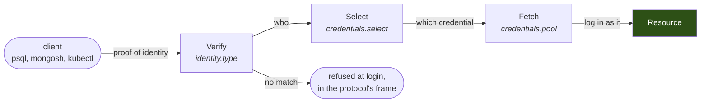

import EnterpriseLimit from '/snippets/EnterpriseLimit.mdx';

A listener can terminate the client's login. The client presents a proof of identity instead of the database password, the Sidecar verifies it, picks an upstream credential from a pool by rule, and logs in to the resource itself. The password, the access token or the certificate lives only where the platform put it. The laptop, the agent sandbox and the CI job never see it.

Every connection then carries a person the Sidecar verified, not a user name the client typed. The audit trail, a held statement and its Slack message name that person.



---

## What the client presents

`identity.type` names the verifier of the client leg. One per listener.

| Type | The client presents | Fits |
|---|---|---|
| `none` | nothing; whoever opened the unix socket is the caller | one workload per pod, the Sidecar on a unix socket beside it |
| `hoop_credential` | a key the Control Plane issued for this listener, as the password or as a bearer token | people on their own machines, shared Sidecars in a cluster |
| `kubernetes` | a projected service account token as the password or bearer | a workload proving which pod it is |
| `spiffe` | a JWT-SVID from the SPIRE Workload API | clusters that run SPIRE |
| `jwt` | a token from any issuer the listener names, as the password or as a bearer: the company identity provider, a CI provider's OIDC token, a gateway's authorization service, the Control Plane | people and pipelines that already have a token, with no proxy and no key minted by hoop |

`none` is accepted on a unix socket only. On a TCP listener the Sidecar needs a proof, and `hoop_credential` and `jwt` need `downstream_tls` on a `postgres`, `mysql` or `clickhouse` lane so the secret never crosses the wire in clear. A `jwt` listener trusts one issuer and one audience, named in its configuration; a token your IdP minted for another service is refused even with a valid signature.

A listener may also keep a list of `passthrough_users`: upstream user names the Sidecar relays unchanged, with the password the client holds. Such a login is recorded as claimed, not verified, and a user not on the list is refused even with the right upstream password. Leave the list empty on a listener that must verify everyone.

---

## Where the upstream credential comes from

The Sidecar stores no credential and calls no vault of its own. It reads material the platform minted and placed where the process can reach it, at the moment it opens the upstream connection. Sources are declared once per process; a listener's pool draws from them.

| Source | Yields | Typical use |
|---|---|---|
| `secret_files` | a user and a password from files under a directory, re-read on every login | a mounted Kubernetes Secret, rotated by the platform |
| `gcp_impersonation` | a short-lived access token for a Google service account, minted through Workload Identity | BigQuery, Spanner, GKE, Cloud SQL IAM |
| `x509` | a client certificate from files, loaded per login | Postgres certificate auth, MongoDB X.509, mTLS |
| `spiffe` | an X509-SVID held in memory from the Workload API, chosen by SPIFFE ID | the certificate case once SPIRE is in place |
| `kerberos` | a GSSAPI initiator from a ticket cache or a keytab | SQL Server integrated auth, Postgres GSSAPI |

A fetch that fails refuses the login with the protocol's own error. There is no fallback to a stale copy.

---

## Configuration

```yaml config.yaml
credentials:                              # process-wide: which sources exist
  secret_files: {dir: /run/hoop-creds}
  gcp_impersonation: {}

listeners:
  - name: appdb
    protocol: postgres
    listen: 0.0.0.0:15432
    upstream: appdb.internal:5432
    downstream_tls: {cert_file: /etc/hoop/tls/appdb.crt, key_file: /etc/hoop/tls/appdb.key}
    identity: {type: hoop_credential}
    credentials:
      pool:
        - {name: rw, source: secret_files, user_file: appdb-rw/user, password_file: appdb-rw/password}
        - {name: ro, source: secret_files, user: app_ro, password_file: appdb-ro/password}
      select:
        rules:                            # first match wins; no match refuses the login
          - {when: {identity.groups: dba}, credential: rw}
          - {credential: ro}
    context: {env: prod}
    propagate: {application_name: "{{.Principal}} via {{.Context.env}}"}

  - name: bigquery
    network: unix
    listen: /run/hoop/bq.sock
    upstream: https://bigquery.googleapis.com
    identity: {type: none}
    context: {owner: jane@acme.com}
    credentials:
      pool:
        - {name: ro, source: gcp_impersonation, service_account: analytics-ro@acme-data.iam.gserviceaccount.com, scopes: [https://www.googleapis.com/auth/bigquery.readonly]}
      select:
        rules:
          - {credential: ro}
```

A `when` key is `identity.subject`, `identity.email`, `identity.groups` (contains), `identity.attributes.<k>` or `context.<k>`. `select.opa: true` asks the listener's OPA endpoint instead, with the identity in `input.context`, and reads `credential` beside `allow` in the answer. One or the other.

Validate before deploying:

```bash
hoop start sidecar --config config.yaml --validate
```

The validator refuses `identity: {type: none}` on a TCP listener, a pool entry naming a source the process does not declare, `credentials` on a listener whose protocol cannot swap, and `identity` beside `identity_header`, `google_identity` or `caller_token`.

---

## What happens at login, per protocol

| Protocol | Client leg | Upstream leg |
|---|---|---|
| `postgres` | password challenge in clear on a unix socket or under TLS; SCRAM-SHA-256 server on a shared TCP listener | startup as the pool user; SCRAM-SHA-256, MD5, cleartext, certificate or GSSAPI; cancel requests mapped to the real backend |
| `mysql` | the full `caching_sha2_password` exchange, through the Sidecar's RSA key | the real password scrambled for the server's plugin |
| `mongodb` | the first `hello` answered locally; SCRAM-SHA-256 server | SCRAM-SHA-256 or `MONGODB-X509` |
| `mssql` | login-only TLS terminated; the LOGIN7 read | LOGIN7 with the pool user, or SSPI from the Kerberos source |
| `clickhouse` | native Hello read | Hello rewritten with the pool user and password |
| `http`, `grpc`, `spanner` | bearer or key read per request | `Authorization` replaced per request; `Impersonate-User` toward a Kubernetes API when `propagate.impersonate_user` is on |
| `oracle` | pass-through users only | the client's own login, relayed |

SQL Server clients set to `Encrypt=strict` cannot be terminated and are refused with a message naming the setting. Integrated Windows logins carry no readable user name; a listener relays them only when `passthrough_users` lists `integrated`. Oracle's login never carries the client's secret, so no verifier can terminate it; a listener on Oracle accepts `none` and `passthrough_users` only.

Every listener with a pool refuses `SET ROLE`, `RESET ROLE`, `SET SESSION AUTHORIZATION`, `EXECUTE AS` and `REVERT` ahead of its own rules. The identity a credential gave the session is the Sidecar's choice, not the client's.

---

## What the user sees when a login is refused

The refusal is written in the protocol's own frame, before any byte reaches the upstream:

```bash
PGPASSWORD=hlc_wrong psql "host=appdb.hoop port=15432 user=jane@acme.com dbname=appdb sslmode=require"
```

```
psql: error: FATAL:  password authentication failed for user "jane@acme.com"
```

The attempt is in the audit trail as a one-event session under the claimed user, with a `violation` carrying rule `identity`. An upstream that refuses the pool credential is a different event: the client reads `upstream authentication failed`, and the trail records an `error`, not a violation.

---

## What the audit trail records

`session_start` carries the verified principal and four metadata keys:

| Key | Value |
|---|---|
| `identity_type` | the verifier that admitted the login |
| `credential` | the pool entry's name, never its material |
| `upstream_user` | the user the Sidecar logged in as |
| `verified` | `true`, or `false` for a pass-through user |

A listener on Postgres can also push the person into the database's own view through `propagate.application_name`; `pg_stat_activity` then shows `jane@acme.com via prod` on a connection that logged in as `app_rw`.

---

## The Control Plane's part

Three things live on the [Control Plane](/core-concepts/control-plane), not in the config file:

- **The owner of a Sidecar.** `owner_email` on the Sidecar names the person a `none` listener acts for, so a workload that proves which pod it is also proves whose it is. A GitOps reconciler writes it with the rest of the entry.
- **Lane credentials.** A user requests a key for one Sidecar lane after signing in; an admin's grant decides who may. The key expires and can be revoked. The Control Plane serves the Sidecar the hashes it must accept, with its configuration, every minute, so a mint or a revocation is in force at the next login with no restart.
- **The person on a hold.** A held statement is filed under the verified principal, or the owner, and the requester is messaged on Slack beside the approver channel.

See [Lane credentials and owners](/control-plane/lane-credentials).

---

## Free and Enterprise

<EnterpriseLimit />

Credential swap on a standalone Sidecar works with `none`, `kubernetes` and `spiffe` and a static `credential_set` in the config file. Minting keys for people, grants, and the owner on a Sidecar need the Control Plane.

---

## Next

<CardGroup cols={2}>
  <Card title="Credentials reference" icon="key" href="/setup/configuration/hoop-sidecar/credentials">
    Every field of `identity`, `credentials`, `select`, `context`, `passthrough_users` and `propagate`.
  </Card>
  <Card title="Lane credentials and owners" icon="user-shield" href="/control-plane/lane-credentials">
    Grants, minting a key, revocation, the owner of a Sidecar, and the person on a hold.
  </Card>
  <Card title="Kubernetes" icon="dharmachakra" href="/install/kubernetes">
    Secret mounts, the SPIRE socket and the ticket cache in the Helm chart.
  </Card>
  <Card title="Guardrails" icon="shield-halved" href="/features/guardrails">
    The rules that run after the login, on every statement.
  </Card>
</CardGroup>
