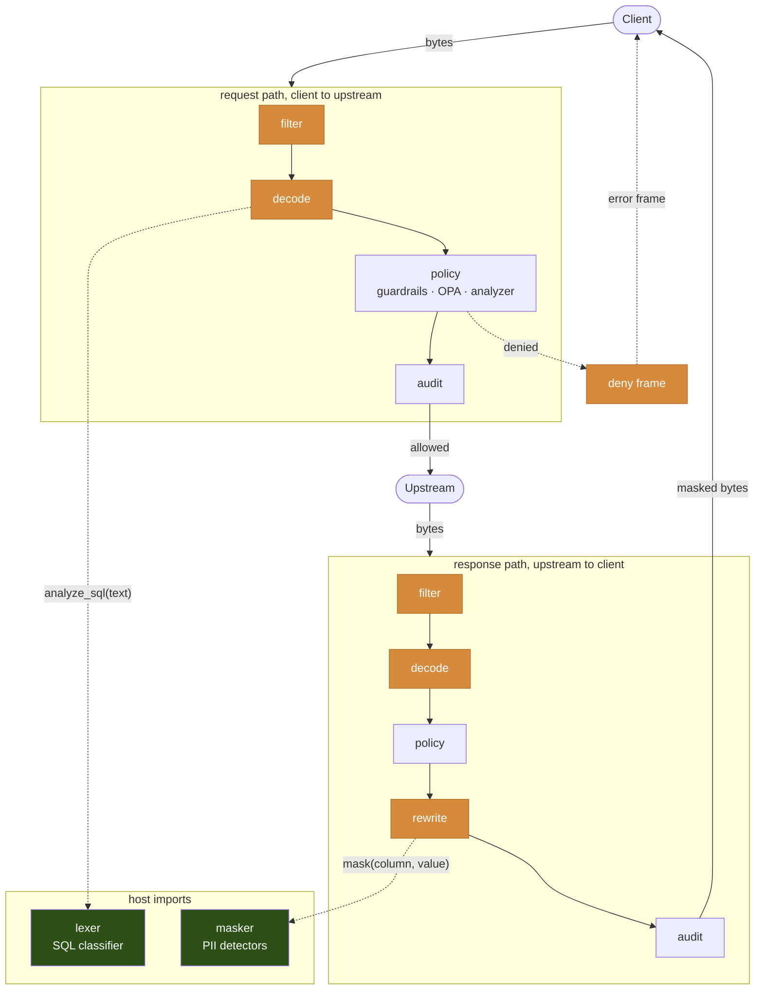
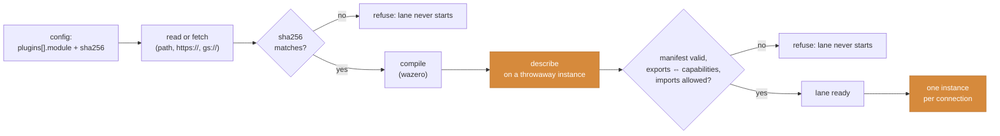

A codec plug-in is one WebAssembly module that decodes one protocol the Sidecar does not ship. The Sidecar loads it at startup, hands it the bytes of each connection, and reads back the statements its rules evaluate. Guardrails, data masking, audit and the AI analyzer treat the result the same way they treat a `postgres` or `http` lane.

Use one when the resource speaks a protocol of its own: an in-house database, a vendor's binary RPC, a legacy TCP service. The vendor writes the decoder once, in Rust, Go, C or any language with a wasm32 target, and ships a single `.wasm` file that runs on every architecture the Sidecar runs on.

---

## Configure a lane

A `plugins` list names each module and the protocol it decodes. A listener then names that protocol the way it names a built-in one:

```yaml config.yaml
plugins:
  - protocol: x-acmewire
    module: /etc/hoop-inspect/plugins/acmewire.wasm
    sha256: 9f2158623935803038f7f8c7b143b518d946ef6d54f8728c1797bd3680833ebf

listeners:
  - name: acme
    protocol: x-acmewire
    listen: 127.0.0.1:19400
    upstream: acme-db.internal:9400
    plugin:
      deny_prefix: ACME
    guardrails:
      rules:
        - name: no-purge
          type: metadata
          metadata:
            x-acmewire.verb: [PURGE]
          message: purges are refused on acme-db
```

| Field | Meaning |
|---|---|
| `plugins[].protocol` | The protocol the module declares. The name starts with `x-`, then `[a-z0-9_-]`. The Sidecar refuses a module whose manifest declares another name, so a swapped file cannot retarget a lane. |
| `plugins[].module` | A local path, or an `https://` or `gs://` URL. |
| `plugins[].sha256` | Hex digest of the module bytes. Required for a URL, optional for a path, checked whenever set. |
| `listeners[].plugin` | A string map the module receives when a connection opens. The module's manifest lists the options it accepts, with their types and defaults; the Sidecar refuses an unknown key. |

Validate before you bind the port:

```bash
hoop start sidecar --config config.yaml --validate
```

The report names each loaded module:

```
config OK: 1 listener(s)
  acme             x-acmewire enforcing 1 rule(s)
                   note: codec plug-in x-acmewire 0.1.0, sha256 9f21…3ebf, capabilities: deny, filter, rewrite, credential, content
```

---

## What a plug-in can do

The module declares its capabilities in its manifest, and the Sidecar turns each one on only when the module exports it:

| Capability | Gives the lane |
|---|---|
| decode (always) | Statements for guardrails, OPA, audit and the analyzer. Operations use the Sidecar's own vocabulary (`select`, `delete`, `other`, …), and the module puts its native verb under `metadata["<protocol>.verb"]` for a `metadata` rule to read. |
| `deny` | A denial in the protocol's own error frame, carrying the message the rule wrote. Without it the Sidecar closes the socket. |
| `filter` | A transform on the bytes before inspection and forwarding, for negotiation or padding the decoder must not see. |
| `rewrite` | Response masking. The module rebuilds its own frames and asks the Sidecar's masker for each cell. Without it a `mask` block on the lane fails validation. |
| `credential` | Per-request identity: the module keeps the credential of the frame that carries one in its own state and leaves only an opaque handle under `metadata["<protocol>.credential"]`. The Sidecar trades the handle back and resolves it the way it does for `http` lanes, only on a lane with per-request identity; on every other lane the handle is inert and the credential never reaches the statement. No plug-in lane has per-request identity yet: `identity_header` is refused on an `x-` protocol, and `google_identity` and `caller_token` are `http` only. The capability is the seam for when one does; a module that declares it today is never asked. |
| `content` | The module's own rendering for the AI analyzer. Without it the Sidecar renders protocol, operation, verb, tables and text. |

A module that carries SQL text calls the Sidecar's own classifier through a host import. The lexer stays in the Sidecar, so an `operation` or `table` rule on a plug-in lane reads the same analysis a `mysql` lane reads.

---

## Where the plug-in runs

The Sidecar owns the socket, the policy, the audit trail and the masker. The module owns one thing: the meaning of the bytes. Every box the module touches below is one export the ABI names; everything else is the same code path a `postgres` lane runs.



Orange is the module; green is the host answering a module's import. The two dotted calls are the whole of what a module can ask the host for on the data path, and both run on the stack of the export that called them.

Reading the request path left to right:

1. **`filter`** sees every chunk first, before inspection and before forwarding. A module without the capability passes bytes through untouched.
2. **`decode`** turns the chunk into statements and reports how many bytes it consumed. The Sidecar keeps the remainder and hands it back with the next read, so the module never sees a torn frame as an error. A SQL-carrying module calls `analyze_sql` here and gets the same classification a `mysql` lane gets.
3. **policy** runs on the statements: guardrail rules (including `metadata` on the module's verb), OPA, the AI analyzer. The module is not consulted.
4. **audit** writes the statement before the forward. A denial writes a `violation` instead and the Sidecar asks the module for a **`deny`** frame to send the client; without the capability it closes the socket.

The response path mirrors it, with one addition: after policy has seen the statements, **`rewrite`** receives the same chunk, calls `mask(column, value)` for each cell it can name, and returns rebuilt frames. The host decides what to mask; the module decides which bytes are cells and recomputes its own length prefixes. The audit `masked` event counts what the masker changed.

Not on the data path: **`take_credential`** runs between `decode` and policy on a lane with per-request identity, trading the handle the module left on the statement for the credential; **`content`** runs when the analyzer wants a rendering of a statement.

Load time is a separate, one-off sequence:



Each accepted connection gets its own instance of the compiled module (or, under `instances: per_lane`, its own `conn` id in one shared instance). A trap, a deadline or a memory cap kills that instance and that connection only; the compiled module and every other connection stay up.

---

## How it fails

Every failure stays inside the connection or the lane it belongs to, and none of them forwards a byte the module did not judge:

- **At load.** A sha256 mismatch, a manifest that names another protocol, a capability without its export, an import the ABI does not grant, or a protocol name without the `x-` prefix refuses the module. The lane does not start, and `--validate` reports the reason.
- **On a connection.** A trap, a call past the manifest's `call_timeout_ms`, or memory above `memory_limit_pages` closes that connection's instance. The Sidecar writes the deny frame when the module offers one and drops the connection. Other connections keep their own instances.
- **On bad output.** A decode result that is not JSON, names an unknown field, or uses an operation outside the vocabulary ends the connection.

The module runs in a sandbox with no filesystem, no network and no environment. It reaches the host through four imports: the SQL classifier, the SQL splitter, the masker (inside a rewrite only) and the log.

---

## Control Plane

A Control Plane serves the `plugins` list and the lanes that use it like any other config section. The Sidecar reports a `plugins` capability on its handshake; the plane withholds the section from a build that does not report it, and grants an `x-` listener protocol by that capability alone. A Sidecar from before plug-ins existed never receives a document it cannot decode.

The plane serves a URL and a digest; the Sidecar fetches, verifies and loads. Point `module` at an `https://` URL the Sidecar can reach, pin the digest, and the same document works for every Sidecar in the fleet.

---

## Next

<CardGroup cols={2}>
  <Card title="Writing a Plug-in" icon="code" href="/setup/configuration/hoop-sidecar/plugins/writing">
    The Rust, Go and C SDKs, the manifest, fixtures and the conformance tool.
  </Card>
  <Card title="ABI Reference" icon="file-code" href="/setup/configuration/hoop-sidecar/plugins/abi">
    Exports, imports, payloads and failure semantics, for any language with a wasm32 target.
  </Card>
  <Card title="Guardrail Rules" icon="shield-halved" href="/setup/configuration/hoop-sidecar/policy-rules#metadata">
    The `metadata` rule type that reads a plug-in's native verb.
  </Card>
  <Card title="Config File" icon="file-code" href="/setup/configuration/hoop-sidecar/config-file">
    Every section and field.
  </Card>
</CardGroup>
